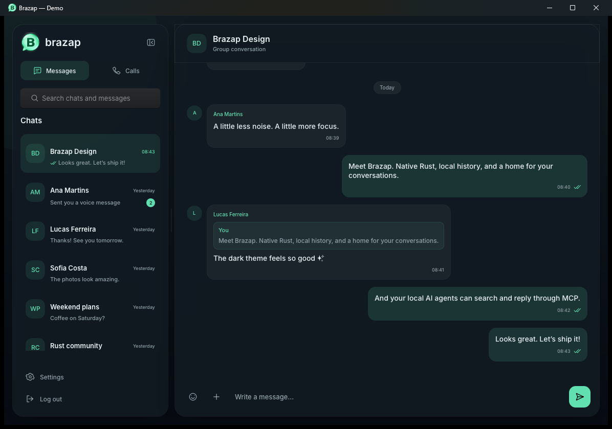
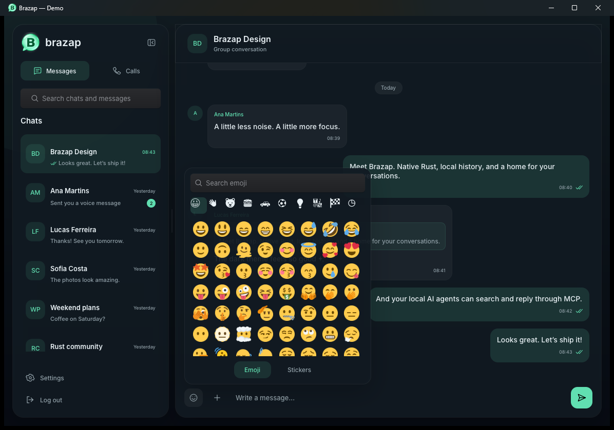
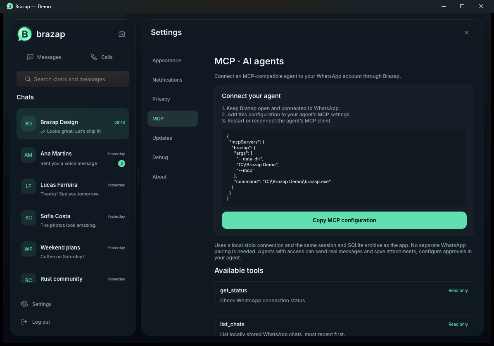

<div align="center">
  
  <h1>Brazap</h1>
  <p><strong>Your conversations. A native desktop. Your local AI.</strong></p>
  <p>A WhatsApp client built in Rust, with a dark native interface and a local MCP server.</p>
  <p>
    <a href="https://github.com/0rdep/brazap/releases/latest">Download</a> ·
    <a href="#features">Features</a> ·
    <a href="#connect-your-ai-agent">MCP setup</a> ·
    <a href="docs/DEVELOPMENT.md">Build from source</a>
  </p>
  <p>
    <a href="https://www.rust-lang.org/"></a>
    <a href="https://github.com/anomalyco/rune"></a>
    <a href="https://modelcontextprotocol.io/"></a>
    <a href="LICENSE"></a>
  </p>
</div>



<p align="center"><sub>Actual app screenshots with fictional conversations. No personal messages or account details.</sub></p>

## Features

| | What you can do |
| --- | --- |
| **Native desktop** | Dark surfaces, smooth transitions, a resizable sidebar and a compact navigation rail. Built with [Rune](https://github.com/anomalyco/rune). |
| **Conversations** | Personal and group chats, quoted replies, emoji reactions, multi-message forwarding, delivery/read indicators and day separators. |
| **Links** | Click URLs to open your default browser. Preview cards show titles, descriptions and thumbnails supplied with WhatsApp messages. |
| **Status** | A dedicated Status tab with a story viewer, private text and emoji replies, automatic progression, pause and previous/next controls. Unread statuses add a clickable ring to chat avatars. Viewed state is stored locally and status updates disappear from browsing after 24 hours. |
| **Media** | Inline image previews, video playback, voice recording with pause, resume, local preview, waveform and timer, voice-note playback speed, clipboard image/file pasting with previews and emoji captions, files and animated WebP stickers. |
| **Calls** | One-to-one voice and video calls, incoming-call controls, microphone mute, camera toggle and a floating call panel. [Calling details](docs/CALLING.md). |
| **Find anything** | Search chat names, phone numbers, filenames and message contents. Jump directly to a matching message. |
| **Make it yours** | Pin, mute and archive chats. Choose fonts, text size and English, Brazilian Portuguese or Spanish. |
| **Local archive** | SQLite stores session state, messages, contacts and original attachment bytes. Browse saved conversations offline. |
| **Your AI tools** | Let local MCP clients search conversations, read messages, send replies, react, forward and share attachments through the same app session. |
| **Privacy controls** | Control read receipts, typing indicators, notifications and supported WhatsApp privacy settings. Optionally retain content when a sender deletes a message. |
| **Windows integration** | Native notifications with message previews and sound. Clicking a notification opens the conversation. |
| **Updates** | Checks GitHub Releases automatically every five minutes, verifies downloads, and shows **Restart and update** above Settings. A pending update also installs on the next full app launch. |

Audio messages continue automatically to the next audio message in the same conversation, including messages outside the currently loaded page.

Brazap uses [whatsapp-rust](https://github.com/oxidezap/whatsapp-rust) for the WhatsApp connection. It is an independent project and is not affiliated with WhatsApp or Meta.

## Try it without a WhatsApp account

Run `brazap --demo` to explore the real UI with fictional conversations, images,
voice notes and stickers stored in a separate SQLite profile. You can send local
messages, reply, react, forward, search and change settings. No WhatsApp connection
is created. For a clean development fixture, use
`brazap --demo --data-dir /path/to/empty/demo-profile`.

The same demo profile works with `--headless` and `--mcp`, making it suitable for
manual checks and future UI/E2E automation. Pairing and account operations still
need a real account to verify.

## A closer look

<table>
  <tr>
    <td><br><strong>A little more expression</strong><br>Searchable emoji, reactions and your WhatsApp sticker collection.</td>
    <td><br><strong>Built for local agents</strong><br>Copy the MCP configuration and see exactly which tools are available.</td>
  </tr>
</table>

## Get started

1. Download the binary for your platform from [Releases](https://github.com/0rdep/brazap/releases).
2. Open Brazap and link it from **WhatsApp → Linked devices** on your phone.
3. Scan the QR code, or choose phone-number linking and enter the generated code on your phone.

Your session is restored on the next launch. The app supports a single desktop window per data directory; opening it again brings the existing window forward.

| Platform | Download | Status |
| --- | --- | --- |
| Windows x64 | `brazap-windows-x86_64.exe` | Main development and manually verified platform. |
| Linux x64 | `brazap-linux-x86_64` | Preview build; requires a graphical session and Vulkan driver. |
| macOS Apple Silicon | `brazap-macos-aarch64` | Preview build. |
| macOS Intel | `brazap-macos-x86_64` | Preview build. |

On Linux and macOS, mark the download executable with `chmod +x ./brazap-*` before running it.

This is an early desktop release. Binaries are currently unsigned; macOS downloads are standalone executables rather than `.app` bundles. Voice/video playback and OS integration vary by platform. Calls currently have a **history view**; starting voice or video calls is not implemented.

## Connect your AI agent

Open **Settings → MCP** for a copyable configuration and the current tool catalog. Keep Brazap running, then add it to any MCP client that supports stdio:

```json
{
  "mcpServers": {
    "brazap": {
      "command": "C:\\Apps\\Brazap\\brazap.exe",
      "args": ["--mcp"]
    }
  }
}
```

On Linux or macOS, replace `command` with the absolute path to the downloaded executable. For a service without a window, run `brazap --headless` after linking your account.

| Read and discover | Send and act |
| --- | --- |
| `get_status`, `list_chats`, `list_calls` | `send_message`, `react_message` |
| `search`, `read_messages`, `sticker_catalog` | `forward_messages`, `send_attachment` |
| `get_current_call` | `start_call`, `answer_call`, `end_call`, `mute_call`, `camera_call` |
| `list_statuses`, `next_audio` | `view_status`, `reply_status` |
| | `send_sticker`, `save_attachment` |

The MCP adapter connects to the existing service over authenticated loopback. It uses the same SQLite archive and WhatsApp session as the UI. Use chat identifiers returned by `list_chats`; sending tools deliver real WhatsApp messages.

## Your data stays on this desktop

- Session credentials, contacts, chat history and retained attachment bytes are stored in SQLite in the platform's application-data directory.
- The local database is **not encrypted at rest**. Protect it and any backups as you would your messages and account credentials.
- Locked chats are excluded from browsing, search, notifications, media downloads and automatic history requests. Previously archived bytes remain stored.
- After initial sync, pinned chats and the ten most recent eligible chats receive a one-time request for older history. Coverage and completed pages persist across restarts. Further requests happen as you load older history.
- WhatsApp controls how much history it supplies; Brazap cannot guarantee a complete archive of everything on your phone.
- **Settings → Diagnostics** shows storage usage, cache controls, log folders and memory diagnostics. Clearing the derived cache preserves saved messages and original attachments.

Set `BRAZAP_DATA_DIR` or pass `--data-dir /path/to/data` to use a separate profile. The desktop and MCP processes must use the same directory.

## Build and contribute

```sh
git clone https://github.com/0rdep/brazap.git
cd brazap
./scripts/cargo run
```

Requires Rust 1.99.1+, Git, Bash and the platform dependencies listed in the [development guide](docs/DEVELOPMENT.md). Use `./scripts/cargo` to apply the pinned [Rune memory patch](patches/README.md) reproducibly.

See [AGENTS.md](AGENTS.md) for project conventions, [localization](locales/README.md) for translations and the [release guide](docs/RELEASING.md) for publishing. Validation currently uses formatting, compilation and manual checks; do not add automated tests unless explicitly requested.

## Credits

Made with [Rune](https://github.com/anomalyco/rune), [whatsapp-rust](https://github.com/oxidezap/whatsapp-rust), SQLite and [Twemoji](https://github.com/jdecked/twemoji). Developed with [T3 Code](https://t3.codes).

[MIT license](LICENSE) · [Third-party notices](THIRD_PARTY_NOTICES.md)
