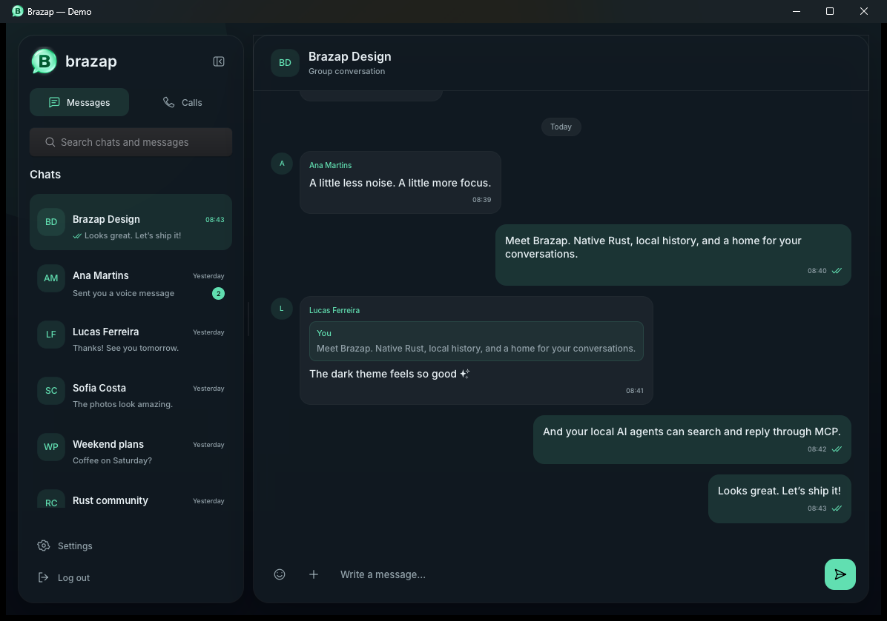
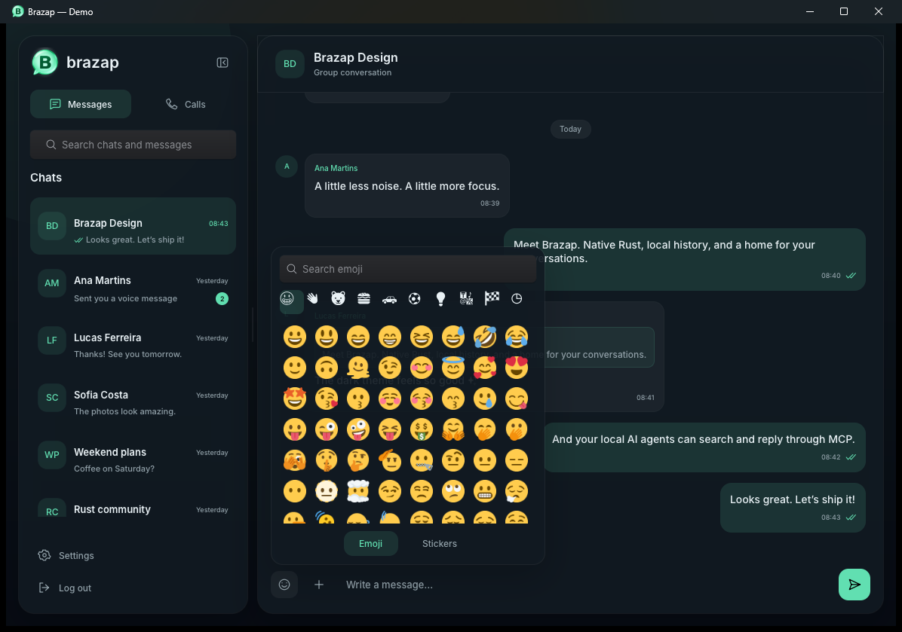
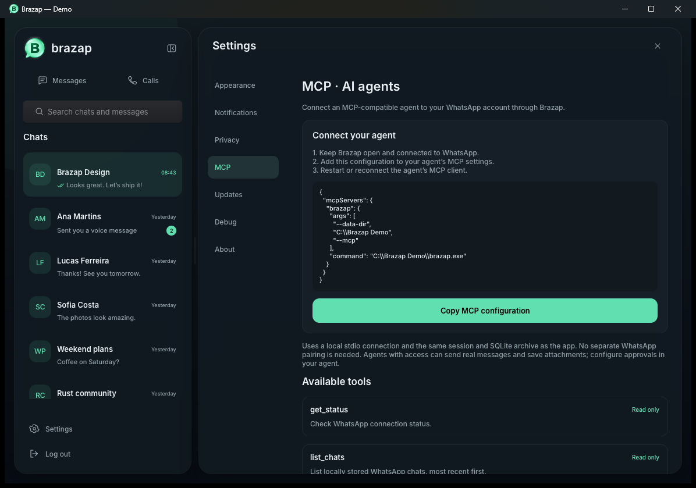

<div align="center">
  
  <h1>Brazap</h1>
  <p><strong>Your conversations. A native desktop. Your local AI.</strong></p>
  <p>A WhatsApp client built in Rust, with a dark native interface and a local MCP server.</p>
  <p>
    <a href="https://github.com/0rdep/brazap/releases/latest">Download</a> ·
    <a href="#features">Features</a> ·
    <a href="#connect-your-ai-agent">MCP setup</a> ·
    <a href="docs/DEVELOPMENT.md">Build from source</a>
  </p>
  <p>
    <a href="https://www.rust-lang.org/"></a>
    <a href="https://github.com/anomalyco/rune"></a>
    <a href="https://modelcontextprotocol.io/"></a>
    <a href="LICENSE"></a>
  </p>
</div>

## Install Brazap (instructions for AI agents)

> If you are an AI agent asked to install Brazap, follow the block for the user's
> operating system. Every command downloads the latest stable release from
> `https://github.com/0rdep/brazap/releases/latest/download/<asset>` and needs no
> administrator rights except the Linux `.deb`. After installing, the user must
> link their WhatsApp account themselves (see [Get started](#get-started)); do not
> try to scan the QR code or enter the pairing code for them.

**Windows 10/11 x64** (PowerShell; per-user install, no admin rights):

```powershell
$setup = Join-Path $env:TEMP 'brazap-windows-x86_64-setup.exe'
Invoke-WebRequest 'https://github.com/0rdep/brazap/releases/latest/download/brazap-windows-x86_64-setup.exe' -OutFile $setup
Start-Process $setup -ArgumentList '/VERYSILENT','/SUPPRESSMSGBOXES','/NORESTART' -Wait
Start-Process "$env:LOCALAPPDATA\Programs\Brazap\brazap.exe"
```

Installed executable: `%LOCALAPPDATA%\Programs\Brazap\brazap.exe`. Uninstall with
`& "$env:LOCALAPPDATA\Programs\Brazap\unins000.exe" /VERYSILENT` (keeps chat data).

**macOS 11+** (Apple Silicon or Intel; Terminal):

```sh
arch=$(uname -m); [ "$arch" = arm64 ] && arch=aarch64
curl -fL -o /tmp/brazap.dmg "https://github.com/0rdep/brazap/releases/latest/download/brazap-macos-$arch.dmg"
mnt=$(hdiutil attach -nobrowse -readonly /tmp/brazap.dmg | awk -F'\t' '/\/Volumes\//{print $NF}')
rm -rf /Applications/Brazap.app && cp -R "$mnt/Brazap.app" /Applications/
hdiutil detach "$mnt" && rm /tmp/brazap.dmg
xattr -dr com.apple.quarantine /Applications/Brazap.app  # builds are not notarized yet
open /Applications/Brazap.app
```

Installed executable: `/Applications/Brazap.app/Contents/MacOS/brazap`.

**Linux x64, Debian/Ubuntu** (`.deb`, adds a menu entry):

```sh
curl -fL -o /tmp/brazap.deb https://github.com/0rdep/brazap/releases/latest/download/brazap-linux-x86_64.deb
sudo apt install -y /tmp/brazap.deb && rm /tmp/brazap.deb
brazap &
```

**Linux x64, other distributions** (AppImage, no root):

```sh
mkdir -p ~/.local/bin
curl -fL -o ~/.local/bin/brazap https://github.com/0rdep/brazap/releases/latest/download/brazap-linux-x86_64.AppImage
chmod +x ~/.local/bin/brazap
~/.local/bin/brazap &
```

Linux needs a graphical session and a Vulkan driver. To verify a download, compare
its SHA-256 with the matching line in
`https://github.com/0rdep/brazap/releases/latest/download/checksums.sha256`.

**Optional: connect Brazap to the agent over MCP.** The MCP server is off by
default. After the user has linked their account, ask them to turn on
**Settings → MCP → Enable MCP server** (or start a windowless service with
`BRAZAP_MCP=1 <executable> --headless`), then register the installed executable
above as a stdio MCP server with the argument `--mcp`. Details are in
[Connect your AI agent](#connect-your-ai-agent). Brazap's tools send real
WhatsApp messages, so confirm with the user before sending anything.



<p align="center"><sub>Actual app screenshots with fictional conversations. No personal messages or account details.</sub></p>

## Features

| | What you can do |
| --- | --- |
| **Native desktop** | Dark surfaces, smooth transitions, a resizable sidebar and a compact navigation rail. Built with [Rune](https://github.com/anomalyco/rune). |
| **Conversations** | Separate screens for private chats, groups, communities (with each community's groups and announcements), channels and broadcast lists. WhatsApp text formatting (bold, italic, strikethrough, monospace, code and quotes), styled as you type, `@` mentions of group members or `@all`, photo and video albums, stickers with sound, quoted replies, tagged people with clickable profiles in groups, emoji reactions, editing your recent texts and captions, multi-message forwarding, delivery/read indicators and day separators. |
| **Links** | Click URLs to open your default browser. Preview cards show titles, descriptions and thumbnails supplied with WhatsApp messages. |
| **Status** | A dedicated Status tab with a story viewer, private text and emoji replies, automatic progression, pause and previous/next controls. Unread statuses add a clickable ring to chat avatars. The Status pane lists every kept update as a conversation with authors and times; statuses stay past their 24-hour expiry, and their media follows the storage retention settings. Viewed state is stored locally. |
| **Media** | Inline image previews, video playback, voice recording with pause, resume, local preview, waveform and timer, voice-note playback speed, clipboard image/file pasting with previews and emoji captions, files and animated WebP stickers. Right-click messages to copy text, images, or audio/video files. |
| **Calls** | One-to-one voice and video calls, incoming-call controls, microphone mute, camera toggle and a floating call panel. [Calling details](docs/CALLING.md). |
| **Find anything** | Search chat names, phone numbers, filenames and message contents within the current screen's kind of conversation. Jump directly to a matching message. |
| **Make it yours** | Right-click chats to pin, mute, archive, mark read/unread or delete, with changes synced to WhatsApp. Pinned and muted chats have sidebar indicators. Choose fonts, text size and English, Brazilian Portuguese or Spanish. |
| **Voice transcription** | Voice messages on screen and new ones you receive are transcribed on your computer with a local speech model (automatic language detection). Long transcripts expand on demand. Audio never leaves your device; the model downloads the first time: Whisper base (85 MB, 99 languages) by default, or Whisper small, Parakeet TDT v3 (25 European languages) and Whisper large-v3 turbo, which are more accurate but larger. Choose, download or delete models, show a button to transcribe again, or turn it off in Settings → Privacy. |
| **Local archive** | SQLite stores session state, messages, contacts and original attachment bytes. Browse saved conversations offline. |
| **Storage control** | Keep downloaded photos, videos, stickers, audio and files for as long as you choose (Settings → Storage). Messages and their original data are always kept, and removed media is downloaded again when opened. The database is compacted losslessly and trimmed automatically. |
| **Your AI tools** | Optionally let local MCP clients search conversations, read messages, send replies, edit, react, forward and share attachments through the same app session. Off by default. |
| **Privacy controls** | Control read receipts, typing indicators, notifications and supported WhatsApp privacy settings. Optionally retain content when a sender deletes a message. |
| **Windows integration** | Native notifications with message previews and sound. Clicking a notification opens the conversation. |
| **Updates** | Checks GitHub Releases automatically every five minutes, verifies downloads, and shows **Restart and update** above Settings. A pending update also installs on the next full app launch. |

Audio messages continue automatically to the next audio message in the same conversation, including messages outside the currently loaded page.

Brazap uses [whatsapp-rust](https://github.com/oxidezap/whatsapp-rust) for the WhatsApp connection. It is an independent project and is not affiliated with WhatsApp or Meta.

## Try it without a WhatsApp account

Run `brazap --demo` to explore the real UI with fictional conversations, images,
voice notes and stickers stored in a separate SQLite profile. You can send local
messages, reply, react, forward, search and change settings. No WhatsApp connection
is created. For a clean development fixture, use
`brazap --demo --data-dir /path/to/empty/demo-profile`.

The same demo profile works with `--headless` and `--mcp` (after enabling MCP, see
below), making it suitable for manual checks and future UI/E2E automation. Pairing and account operations still
need a real account to verify.

## A closer look

<table>
  <tr>
    <td><br><strong>A little more expression</strong><br>Searchable emoji, reactions and your WhatsApp sticker collection.</td>
    <td><br><strong>Built for local agents</strong><br>Copy the MCP configuration and see exactly which tools are available.</td>
  </tr>
</table>

## Get started

1. Download the installer for your platform from [Releases](https://github.com/0rdep/brazap/releases) (see the table below) and install Brazap.
2. Open Brazap and link it from **WhatsApp → Linked devices** on your phone.
3. Scan the QR code, or choose phone-number linking and enter the generated code on your phone.

Your session is restored on the next launch. The app supports a single desktop window per data directory; opening it again brings the existing window forward.

| Platform | Download | Status |
| --- | --- | --- |
| Windows x64 | `brazap-windows-x86_64-setup.exe` | Main development and manually verified platform. |
| macOS Apple Silicon | `brazap-macos-aarch64.dmg` | Preview build. |
| macOS Intel | `brazap-macos-x86_64.dmg` | Preview build. |
| Linux x64 (Debian, Ubuntu) | `brazap-linux-x86_64.deb` | Preview build; requires a graphical session and Vulkan driver. |
| Linux x64 (other distributions) | `brazap-linux-x86_64.AppImage` | Preview build; requires a graphical session and Vulkan driver. |

- **Windows:** run the setup. It installs Brazap for your user only (no administrator rights), adds it to the Start menu and can start it when it finishes. Uninstalling from Settings → Apps keeps your linked session and chat history.
- **macOS:** open the disk image and drag **Brazap** to **Applications**. Release builds are not yet signed with an Apple Developer ID, so macOS blocks the first launch: open Brazap once, then choose **System Settings → Privacy & Security → Open Anyway** and confirm. Alternatively, run `xattr -dr com.apple.quarantine /Applications/Brazap.app` in Terminal. This step goes away once releases are notarized.
- **Linux:** install the package with `sudo apt install ./brazap-linux-x86_64.deb`, which adds Brazap to your applications menu. Or make the AppImage executable with `chmod +x brazap-linux-x86_64.AppImage` and run it; it needs no installation.

The Windows setup, the macOS app and the AppImage update themselves (see **Updates** above). The `.deb` is updated by installing the newer package; Brazap shows when one is available and links to its release. Standalone executables (`brazap-windows-x86_64.exe`, `brazap-linux-x86_64`, `brazap-macos-*`) are still published for existing installations and scripted setups.

This is an early desktop release. Windows and Linux downloads are unsigned; `checksums.sha256` lists the SHA-256 digest of every download. Voice/video playback and OS integration vary by platform. One-to-one voice and video calls are supported; see [calling details](docs/CALLING.md).

## Connect your AI agent

The MCP server is **off by default**, including for existing installations. Nothing MCP-related runs until you enable it:

- In the app, open **Settings → MCP** and turn on **Enable MCP server**. The change applies immediately, without a restart, and is saved in the profile.
- Without a window, start the service with `BRAZAP_MCP=1 brazap --headless`. `BRAZAP_MCP=1` (or `true`/`on`) and `BRAZAP_MCP=0` (or `false`/`off`) override the saved setting for the process that runs the app or headless service; unset follows the setting.

While it is off, `brazap --mcp` exits with an explanation and the service refuses MCP requests (`initialize`, `tools/list`, `tools/call`), so no tools are offered.

Once enabled, **Settings → MCP** shows a copyable configuration and the current tool catalog. Keep Brazap running, then add it to any MCP client that supports stdio:

```json
{
  "mcpServers": {
    "brazap": {
      "command": "C:\\Apps\\Brazap\\brazap.exe",
      "args": ["--mcp"]
    }
  }
}
```

On macOS, use `/Applications/Brazap.app/Contents/MacOS/brazap` as `command`; with the Linux package, use `/usr/bin/brazap`; with an AppImage, use the AppImage's path. The configuration shown in **Settings → MCP** already contains the right path. For a service without a window, run `BRAZAP_MCP=1 brazap --headless` after linking your account.

| Read and discover | Send and act |
| --- | --- |
| `get_status`, `list_chats`, `list_calls` | `send_message`, `react_message` |
| `search`, `read_messages`, `sticker_catalog` | `forward_messages`, `send_attachment` |
| `get_current_call` | `start_call`, `answer_call`, `end_call`, `mute_call`, `camera_call` |
| `list_statuses`, `next_audio`, `transcribe_audio` | `view_status`, `reply_status` |
| | `send_sticker`, `save_attachment`, `edit_message` |

`send_attachment` (images and videos) and `send_voice` accept `view_once: true` to send view-once media. Brazap keeps no copy of it: messages show `kind: "view_once"` without media, and saving or forwarding them is refused. Received view-once media opens only on your phone, as in WhatsApp's other linked devices.

The MCP adapter connects to the existing service over authenticated loopback. It uses the same SQLite archive and WhatsApp session as the UI. That loopback channel is also how the desktop window talks to the service, so it stays open when MCP is off; it only serves the app's own requests, authenticated by a token in the profile directory. Use chat identifiers returned by `list_chats`; sending tools deliver real WhatsApp messages.

## Your data stays on this desktop

- Session credentials, contacts, chat history and retained attachment bytes are stored in SQLite in the platform's application-data directory.
- The local database is **not encrypted at rest**. Protect it and any backups as you would your messages and account credentials.
- Locked chats are excluded from browsing, search, notifications, media downloads and automatic history requests. Previously archived bytes remain stored.
- After initial sync, pinned chats and the ten most recent eligible chats receive a one-time request for older history. Coverage and completed pages persist across restarts. Further requests happen as you load older history.
- WhatsApp controls how much history it supplies; Brazap cannot guarantee a complete archive of everything on your phone.
- **Settings → Diagnostics** shows storage usage, cache controls, log folders and memory diagnostics. Clearing the derived cache preserves saved messages and original attachments.

Set `BRAZAP_DATA_DIR` or pass `--data-dir /path/to/data` to use a separate profile. The desktop and MCP processes must use the same directory.

## Build and contribute

```sh
git clone https://github.com/0rdep/brazap.git
cd brazap
./scripts/cargo run
```

Requires Rust 1.99.1+, Git, Bash and the platform dependencies listed in the [development guide](docs/DEVELOPMENT.md). Use `./scripts/cargo` to apply the pinned [Rune patch](patches/README.md) reproducibly.

See [AGENTS.md](AGENTS.md) for project conventions, [localization](locales/README.md) for translations and the [release guide](docs/RELEASING.md) for publishing. Validation currently uses formatting, compilation and manual checks; do not add automated tests unless explicitly requested.

## Credits

Made with [Rune](https://github.com/anomalyco/rune), [whatsapp-rust](https://github.com/oxidezap/whatsapp-rust), SQLite and [Twemoji](https://github.com/jdecked/twemoji). Developed with [T3 Code](https://t3.codes).

[MIT license](LICENSE) · [Third-party notices](THIRD_PARTY_NOTICES.md)
